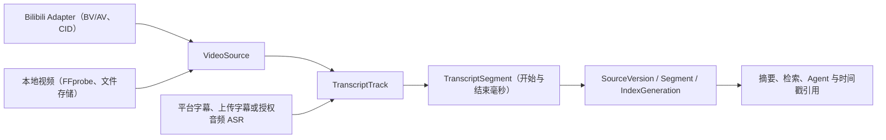

# 架构

本地已加入独立的 Python AI Engine，入口为 FastAPI 的 `GET /healthz`。该路径报告 HTTP 进程状态。模型和 Java–Python 业务调用契约将随第一条联合功能交付。端口与启动顺序见[本地开发环境](DEVELOPMENT.md)。

浏览器中的 React + TypeScript 页面经 Vite 代理访问 Java API。Spring Boot 将 HTTP 请求交给资料服务，解析组件提取正文，JdbcClient 把提取结果写入 PostgreSQL。Flyway 在启动时应用版本化迁移。

| 方法与路径 | 职责 |
| --- | --- |
| GET /api/sources | 返回按导入时间排序的资料元数据 |
| GET /api/sources/{id} | 获取元数据和保存的正文 |
| GET /api/sources/{id}/transcript | 读取 SRT/VTT 的有序片段，含 sequence、startMs、endMs、text |
| POST /api/sources | JSON 接收 title 和 content，或 multipart 接收 file 和可选 title |

成功导入返回 201、Location 和资料详情。无记录返回 404，上传超限返回 413，不支持的格式返回 415，提取失败返回 422。查询使用参数绑定，正文以纯文本渲染。

资料元数据和正文目前共用一行，列表查询只读元数据。文件在解析过程中读取，数据库保存提取后的文本和原文件名。字幕时间戳随文本保留，PDF 页码定位和原始文件归档后续以独立模型提供。

字幕上传先解码、校验 cue 格式和正时间区间，再执行单条 INSERT。时间轴读接口对存量 SRT/VTT 按需解析，普通资料返回 404，历史字幕格式错误返回 422。原文详情沿用原有契约。当前支持常见文本字幕、重叠和多行正文，忽略布局设置与 VTT 注释、样式及区域块。片段上限为 10000。

## 目标视频管线

VideoSource 记录来源、分 P 或文件存储引用。TranscriptTrack 记录语言、种类、处理版本和状态。TranscriptSegment 以轨道和序号标识，引用还应携带来源版本。Java 管理资料、事务、任务状态和索引发布，Python Engine 处理音视频、检索和 Agent。关键帧后续可按时间关联片段。
