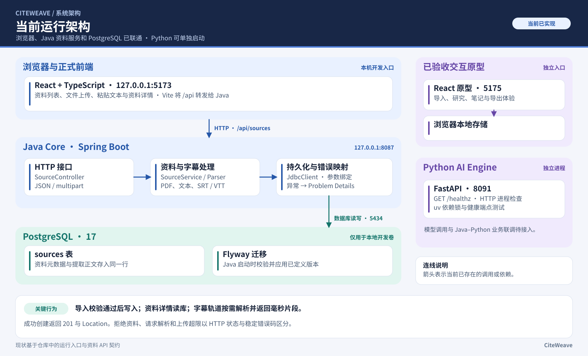
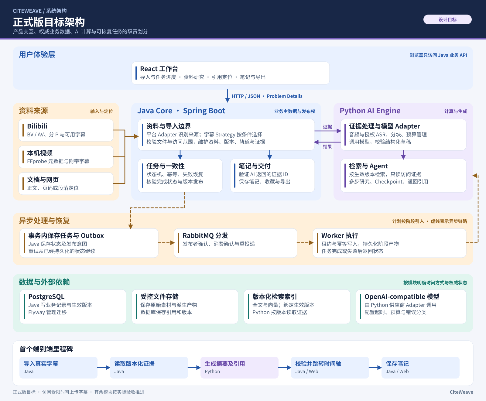
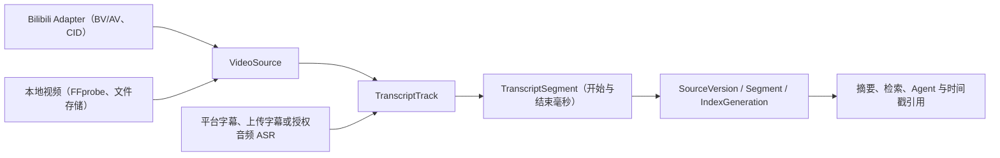

# 架构

## 架构图

### 首次联调时的运行架构

[打开现状矢量图](diagrams/current-architecture.svg)。正式前端通过 Vite 访问 Java 资料 API，Java 通过 JdbcClient 读写 PostgreSQL。原型由独立入口提供，Python 目前提供本机健康检查。

### 正式版目标架构

[打开目标矢量图](diagrams/target-architecture.svg)。实线表示目标中的常规调用，虚线表示计划分阶段引入的异步链路。Java 负责业务状态和版本发布，Python 处理证据与生成，Web 用通过校验的引用定位资料。交付优先级见[正式开发计划](../planning/IMPLEMENTATION_PLAN.md)。

## 已实现的接口与存储

Python AI Engine 当前提供 FastAPI 健康检查。Python 包内已有字幕证据模型、引用校验和非流式模型供应商适配器。Java 已提供 Bilibili 输入规范化与公开分 P 预览，预览成功后仍需用户确认并关联字幕。真实模型业务端点和正式 Web 的研究体验待联调。各服务的已实现入口与响应示例见[接口目录](../development/API_REFERENCE.md)，进程端口与启动顺序见[本地开发环境](../development/DEVELOPMENT.md)。

浏览器中的 React + TypeScript 页面经 Vite 代理访问 Java API。Spring Boot 将 HTTP 请求交给资料服务，解析组件提取正文，JdbcClient 把提取结果写入 PostgreSQL。Flyway 在启动时应用版本化迁移。

| 方法与路径 | 职责 |
| --- | --- |
| GET /api/sources | 返回按导入时间排序的资料元数据 |
| GET /api/sources/{id} | 获取元数据和保存的正文 |
| GET /api/sources/{id}/transcript | 读取 SRT/VTT 的有序片段，含 sequence、startMs、endMs、text |
| POST /api/sources | JSON 接收 title 和 content，或 multipart 接收 file 和可选 title |

成功导入返回 201、Location 和资料详情。无记录返回 404，上传超限返回 413，不支持的格式返回 415，提取失败返回 422。查询使用参数绑定，正文以纯文本渲染。

资料元数据和正文目前共用一行，列表查询只读元数据。文件在解析过程中读取，数据库保存提取后的文本和原文件名。字幕时间戳随文本保留，PDF 页码定位和原始文件归档后续以独立模型提供。

字幕上传先解码、校验 cue 格式和正时间区间，再执行单条 INSERT。时间轴读接口对存量 SRT/VTT 按需解析，普通资料返回 404，历史字幕格式错误返回 422。原文详情沿用原有契约。当前支持常见文本字幕、重叠和多行正文，忽略布局设置与 VTT 注释、样式及区域块。片段上限为 10000。

## 资料、证据与派生产物的归属（成品设计）

当前 Flyway V1 只持久化资料元数据与正文。下表约定后续模块交接时必须保留的信息；具体表、约束和索引随相应功能在新迁移中实现。

| 对象 | 谁管理 | 身份、定位与生命周期 |
| --- | --- | --- |
| 资料与内容版本 | Java 资料模块、PG | 资料 ID 表示逻辑资料，版本标识绑定一次不可变内容。文件名、标题和显示顺序均可重复。旧资料数字 ID 及原文读取契约继续有效。 |
| 原始文件、视频分 P 与字幕轨道 | Java 导入模块 | 本地文件经受控存储引用关联内容版本。Bilibili 预览保留 BV 与 CID；确认后绑定实际分 P 及字幕轨道。时间区间在指定轨道内解释，允许多轨和重叠。 |
| 可引用证据 | Java 证据生产方 | 每个证据标识可解析到指定资料版本、原始片段及定位。字幕定位到轨道、片段与毫秒区间；首版文本定位到版本内稳定段落。已有 PDF 仅保存提取正文，页码定位须有提取时保留的映射。 |
| 检索块、向量与索引版本 | Python 计算，Java 校验并发布 | 切块可跨多个证据，也可只覆盖部分证据。保存块与原始证据的映射。更换切块或 Embedding 配置后构建新索引，历史笔记继续引用原证据。 |
| 研究任务、回答、笔记和记忆 | Java 持久化与授权，Python 生成候选，Web 呈现和确认 | 回答和导出保留来源版本及证据标识；用户笔记和已确认记忆有各自修订。重建索引或撤销记忆后仍按当前权限核对历史笔记，界面明确提示来源不可访问。 |

### 服务间交接与首次联合交付

Java 从当前工作区的已存字幕构造证据批次，跨服务标识按字符串传递，负责将标识解析回原始位置。Python 按预算选取本次实际交给模型的证据，解析结构化草稿并只接受该子集内的引用。Java 核验运行归属、资料版本、授权与返回引用后保存结果。Web 通过 Java 打开原句，展示模型不可用、证据不足或来源访问受限的可操作状态。首批黄金样例与字段约束见[证据契约](../development/AI_EVIDENCE_CONTRACT.md)。逐项实施日期见[正式开发计划](../planning/IMPLEMENTATION_PLAN.md)。

## 目标视频管线

VideoSource 记录来源、分 P 或文件存储引用。TranscriptTrack 记录语言、种类、处理版本和状态。TranscriptSegment 以轨道和序号标识，引用还应携带来源版本。Java 管理资料、事务、任务状态和索引发布，Python Engine 处理音视频、检索和 Agent。关键帧后续可按时间关联片段。
